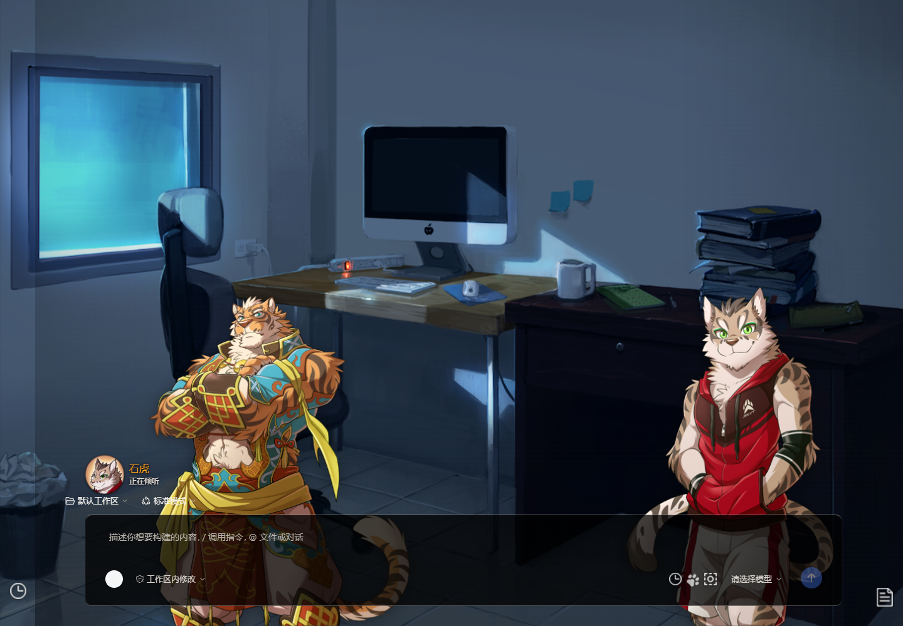
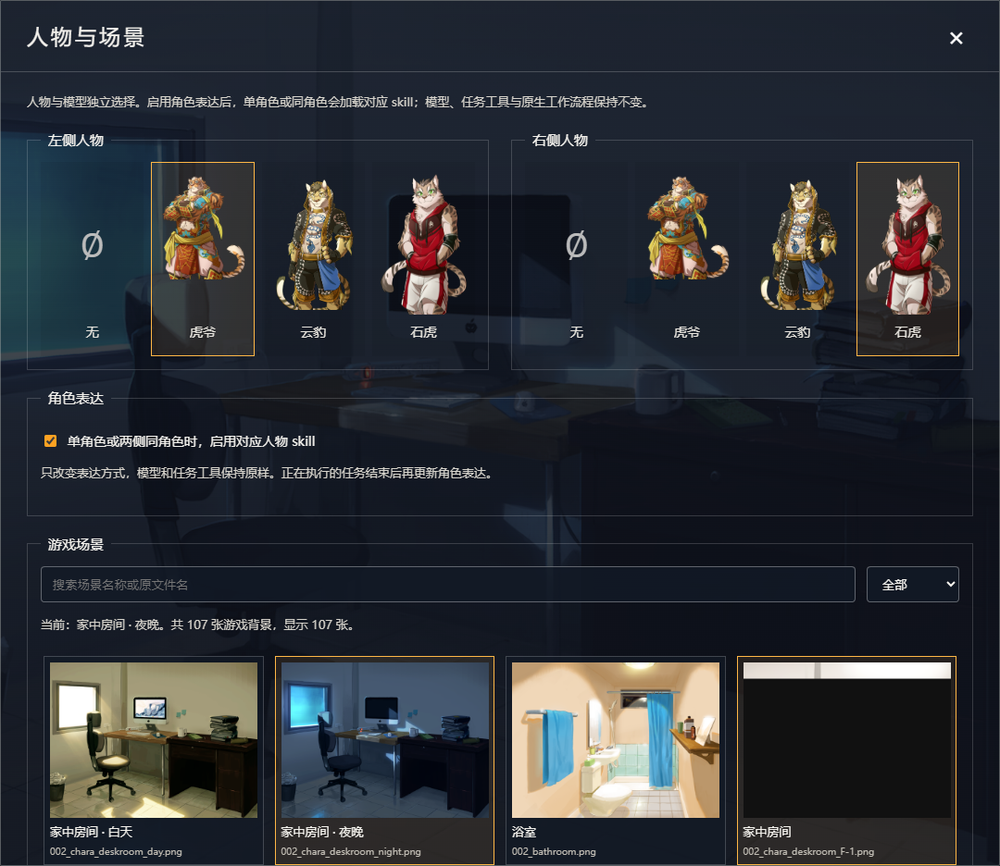
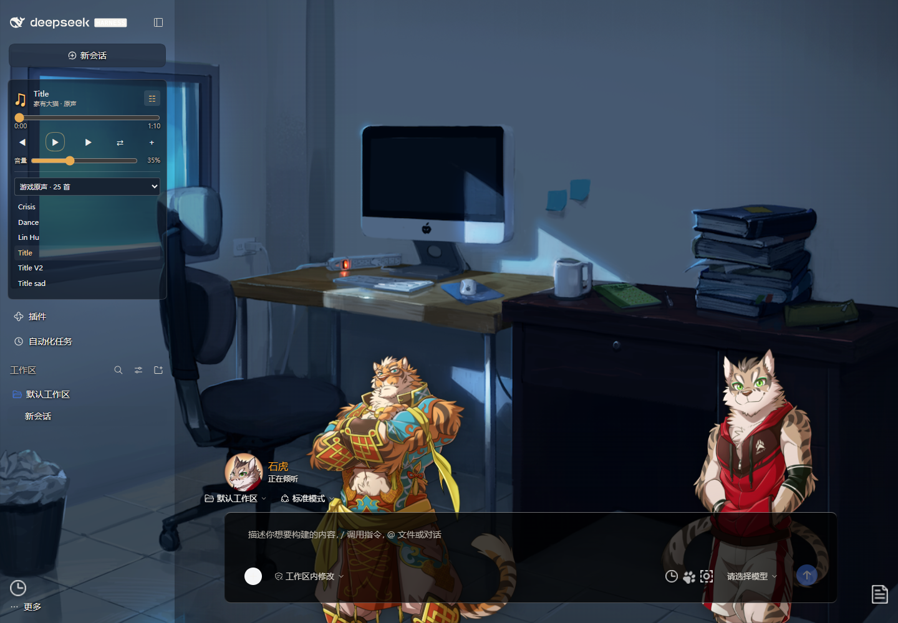

# DSH Nekojishi VN · 讓 Agent 的工作成為一幕故事

[简体中文](README.md) · [繁體中文](README.zh-TW.md) · [日本語](README.ja.md)

將 DeepSeek Harness 的任務介面化為視覺小說舞臺：場景、左右人物、透明懸浮對話、貼近視窗底部的輸入框，以及隨真實任務狀態切換的表情。模型、專案、工具、權限和提問流程仍由原生 DSH 管理。

## 主要特色

- 思考、執行、回覆、等待回答、失敗與目標完成，各有明確狀態回饋。
- 人物底部跟隨視窗，文字依輪廓安全邊界避讓；側欄開啟時重新配置，資源全螢幕時遮蔽並模糊底層舞臺。
- 人物與模型分別選擇，左右皆可不選人物；單一角色或兩側相同角色可啟用對應表達 skill。
- 音樂播放器包含進度、音量、隨機播放，以及本機歌曲與播放清單匯入；重新啟動不會自動播放。
- 可切回原生介面；外掛頁與自動化任務頁會暫時隱藏人物和頭像。

## 下載即可體驗

公開版預設為輕量舞臺，附原創場景與合成音樂，不加入替代人物；基本介面**不需要遊戲檔案**。原版人物需自行從本機遊戲匯入。已驗證的宿主版本為官方 Windows DSH 0.2.1-rc.2。

下載並解壓縮，或複製本倉庫；先從系統匣退出 DSH，再於專案目錄執行：

```powershell
.\install.ps1
```

倉庫包含預先建置的前端；預設安裝不需要另外安裝 Node、npm 或 Python。安裝程式使用官方桌面端內建的執行環境，不更改 API Key 或執行原則。可攜版以 `-DesktopExe` 指定路徑，CLI 使用者可指定 `-Profile web`。

## 選用本機遊戲資源

```powershell
npm ci
python -m pip install -r scripts/requirements.txt
python scripts/import-resources.py --game-dir '你的 Nekojishi 安裝目錄'
npm run build
.\install.ps1 -IncludeLocalGameResources
```

目前支援 Nekojishi 1.06s 的 107 張背景、25 首音樂、角色圖像與中文分支引用。匯入僅讀取本機遊戲，產物留在本機；請勿將原版資源、台詞庫或完整資源安裝包公開上傳。

`skills/` 可公開分享的部分是人工歸納的角色表達規則，沒有原始台詞庫，也不是模型權重訓練。技術能力、權限與任務完成判定保留；沒有本機引用時，不宣稱已核實劇情。

程式與原創示範資源採 MIT，第三方遊戲內容不在授權範圍內，詳見 [第三方說明](THIRD_PARTY_NOTICES.md)。介面目前仍以簡體中文呈現；繁體中文與日文為說明文件。其他作業系統、宿主版本與外觀外掛組合尚未全面驗證。

完整安裝選項、開發方式及限制請參閱[主要說明](README.md)和[驗證紀錄](docs/VALIDATION.md)。

## 主題畫面

以下為隔離環境匯入本機遊戲資源後的實際畫面。遊戲人物與美術權利歸原權利人所有，僅展示主題效果；公開安裝包不含這些遊戲資源。






